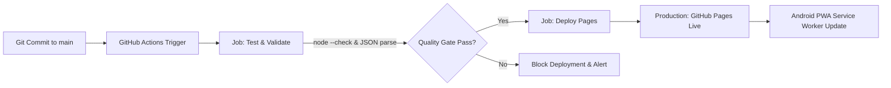

# Cấu Hình Continuous Deployment (CD) - MeowMindLog

## 1. Tổng Quan Kiến Trúc Pipeline
MeowMindLog là ứng dụng Progressive Web App (PWA) client-side thuần túy (HTML5, Vanilla CSS, Vanilla JS ES6). Không cần trình biên dịch nặng (zero-build), quy trình triển khai CD tập trung vào tính tự động hóa, kiểm thử cú pháp tức thời và xuất bản lên GitHub Pages với chứng chỉ bảo mật HTTPS (bắt buộc cho Service Worker).

---

## 2. Đặc Tả Pipeline GitHub Actions
File cấu hình: `.github/workflows/deploy.yml`

| Bước | Hành Động | Mục Đích |
| :--- | :--- | :--- |
| **Trigger** | `push` vào nhánh `main` hoặc `workflow_dispatch` (thủ công) | Kích hoạt tự động khi có mã nguồn mới được merge vào nhánh chính |
| **Concurrency** | Nhóm `pages`, `cancel-in-progress: false` | Tránh xung đột các lượt deploy đồng thời |
| **Validation Gate** | `node --check app.js`, `node --check sw.js`, parse `manifest.json` | Đảm bảo mã nguồn hoàn toàn không có lỗi cú pháp trước khi cho phép deploy |
| **Pages Config** | `actions/configure-pages@v5` | Cấu hình base URL và quyền truy cập Pages |
| **Artifact Packaging** | `actions/upload-pages-artifact@v3` | Đóng gói toàn bộ thư mục root của web app |
| **Deployment Execution** | `actions/deploy-pages@v4` | Đưa nội dung lên hạ tầng CDN của GitHub Pages |

---

## 3. Quản Lý Môi Trường (Environment Matrix)

### Môi trường Local Preview (Phát triển & Chạy thử)
- **Công cụ**: `npx serve .` hoặc `python -m http.server 8000`
- **Địa chỉ truy cập**: `http://localhost:3000` hoặc `http://localhost:8000`
- **Mục đích**: Kiểm tra nhanh các tính năng, giao diện giao diện Responsive trên trình duyệt máy tính hoặc DevTools thiết bị di động.

### Môi trường Production (Sản phẩm chính thức)
- **Hạ tầng**: GitHub Pages CDN
- **URL**: `https://<tên-tài-khoản>.github.io/MeowMindLog/`
- **HTTPS**: Kích hoạt mặc định (bắt buộc để trình duyệt Android cho phép cài đặt PWA vào màn hình chính).

---

## 4. Quản Lý Bảo Mật & Biến Môi Trường
- **Bảo mật bí mật (Secrets)**: Ứng dụng MeowMindLog chạy offline 100%, dữ liệu lưu cục bộ trong `IndexedDB` của người dùng. Pipeline không yêu cầu bất kỳ API key, Database URL hay Secret token bên ngoài nào.
- **Quyền tối thiểu (Least Privilege)**: Workflow chỉ yêu cầu `contents: read`, `pages: write`, `id-token: write`.
