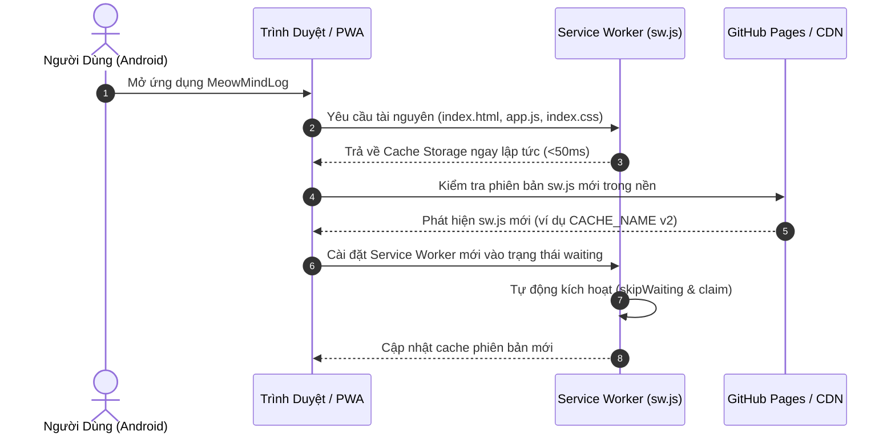

# Chiến Lược Triển Khai (Deployment Strategy) - MeowMindLog

## 1. Phương Thức Triển Khai (Deployment Method)
Ứng dụng MeowMindLog áp dụng chiến lược **Triển Khai Tĩnh Nguyên Tử (Atomic Static Deployment)** kết hợp **Vòng Đời Cập Nhật Service Worker PWA**:

1. **Atomic Swapping trên CDN**: GitHub Pages và các dịch vụ static hosting triển khai mã nguồn mới theo từng commit SHA hoàn chỉnh. Quá trình đổi phiên bản diễn ra tức thời (zero downtime), không bao giờ xảy ra tình trạng nạp lẫn lộn file cũ và file mới.
2. **Offline-First Resilience**: Ngay cả khi đường truyền mạng bị ngắt quãng trong quá trình người dùng truy cập, Service Worker trên điện thoại Android vẫn tiếp tục phục vụ phiên bản offline đã lưu trong bộ nhớ đệm Cache Storage mà không làm gián đoạn trải nghiệm của người dùng.

---

## 2. Chiến Lược Cập Nhật Cache & Service Worker

### Quy tắc cập nhật phiên bản (Versioning Rules):
- Khi cập nhật giao diện hoặc logic ứng dụng, tăng định danh `CACHE_NAME` trong file `sw.js` (ví dụ từ `meowmindlog-v1` lên `meowmindlog-v2`).
- Service Worker trong sự kiện `activate` sẽ tự động quét và xóa sạch tất cả các cache cũ không trùng tên, giải phóng dung lượng bộ nhớ cho thiết bị.
- Dữ liệu nhật ký công việc của người dùng được bảo vệ tuyệt đối vì nằm trong cơ sở dữ liệu `IndexedDB` độc lập, hoàn toàn không bị ảnh hưởng bởi việc xóa hay làm mới Cache Storage tĩnh.

---

## 3. Bảo Vệ Dữ Liệu Người Dùng (Data Safety & Zero Data Loss)
- **Tách biệt dữ liệu và mã nguồn**: Mã nguồn tĩnh (`html`, `css`, `js`) lưu ở Cache Storage; dữ liệu nhật ký, tiến độ, chuỗi ngày liên tục lưu ở `IndexedDB` (`meowmindlog_db`).
- **Tương thích ngược (Backward Compatibility)**: Khi có bản cập nhật mới, logic nạp dữ liệu luôn kiểm tra phiên bản cấu trúc database (`onupgradeneeded`), đảm bảo không có bất kỳ tác vụ nào làm mất dữ liệu đã ghi chép của người dùng.
- **Dự phòng khẩn cấp**: Cung cấp sẵn tính năng Xuất JSON / CSV tại tab "💾 Sao Lưu" để người dùng có thể tải bản sao lưu dữ liệu về điện thoại bất cứ lúc nào.
