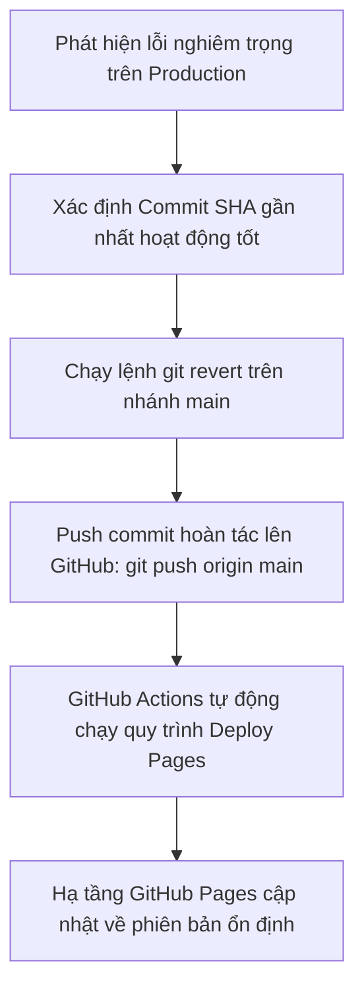

# Quy Trình Hoàn Tác & Khôi Phục (Rollback Runbook) - MeowMindLog

## 1. Dấu Hiệu Kích Hoạt Hoàn Tác (Rollback Triggers)
Quy trình hoàn tác cần được thực hiện ngay lập tức khi phát hiện một trong các sự cố nghiêm trọng sau:
1. **Lỗi chặn thao tác chính (P1 Blocker)**: Người dùng không thể tạo mới, sửa hoặc đánh dấu hoàn thành nhật ký công việc.
2. **Lỗi khởi động cơ sở dữ liệu (Database Crash)**: `IndexedDB` nạp thất bại và hệ thống không thể tự động fallback sang `LocalStorage`.
3. **Lỗi Service Worker loop**: Vòng lặp tải lại trang vô tận hoặc không tải được tài nguyên tĩnh cần thiết.

---

## 2. Quy Trình Hoàn Tác Cấp Mã Nguồn & Hạ Tầng (Git / Hosting Rollback)

Khi phát hiện bản build có lỗi nghiêm trọng trên production:



### Các bước thao tác lệnh:
```bash
# 1. Xem lịch sử các commit gần nhất
git log -n 5 --oneline

# 2. Tạo commit hoàn tác lại commit bị lỗi (thay <bad-commit-hash> bằng mã hash thực tế)
git revert <bad-commit-hash> --no-edit

# 3. Đẩy lên nhánh main để kích hoạt lại pipeline CD
git push origin main
```
Pipeline GitHub Actions sẽ chạy qua bước kiểm tra cú pháp và triển khai lại phiên bản hoạt động tốt trong vòng 1-2 phút.

---

## 3. Quy Trình Hoàn Tác Phía Khách Hàng (Client-Side Cache Purge)

Để đảm bảo các thiết bị Android đã cài đặt PWA nhận ngay phiên bản rollback:
1. Trong file `sw.js`, tăng giá trị `CACHE_NAME` (ví dụ từ `meowmindlog-v2` lên `meowmindlog-v3-rollback`).
2. Khi người dùng mở ứng dụng, Service Worker mới sẽ xóa sạch bộ nhớ cache phiên bản lỗi và nạp lại toàn bộ file tĩnh từ phiên bản ổn định.

---

## 4. An Toàn Dữ Liệu Trong Quá Trình Hoàn Tác (Data Recovery)
- Quá trình hoàn tác mã nguồn hoàn toàn **KHÔNG tác động hay xóa bỏ** các bản ghi nhật ký trong `IndexedDB` của người dùng.
- Trong trường hợp xấu nhất nếu người dùng gặp sự cố dữ liệu bất thường:
  1. Hướng dẫn người dùng mở tab "💾 Sao Lưu" để tải file `meowmindlog-backup-*.json` về máy.
  2. Sử dụng tính năng "Chọn file sao lưu (.json) để phục hồi" để khôi phục lại nhật ký đầy đủ.
