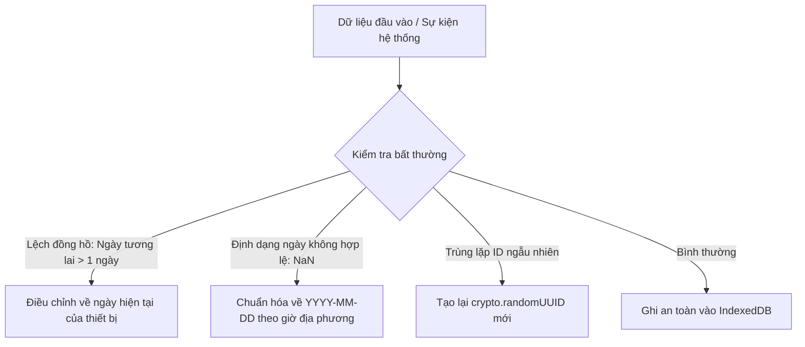

# Cấu Hình Phát Hiện Bất Thường (Anomaly Detection Configuration) - MeowMindLog

## 1. Mục Tiêu Phát Hiện Bất Thường
Ứng dụng ghi chép nhật ký cá nhân chạy cục bộ thường gặp các bất thường liên quan đến sai lệch đồng hồ hệ thống (clock skew), múi giờ di chuyển, hoặc dữ liệu thời gian không hợp lệ. Bản cấu hình này thiết lập các rào chắn tự động phát hiện và xử lý.

---

## 2. Các Bất Thường & Cơ Chế Xử Lý (Heuristics & Remediation)

| Loại Bất Thường | Dấu Hiệu Nhận Biết | Mức Độ | Cơ Chế Tự Động Khắc Phục |
| :--- | :--- | :--- | :--- |
| **Lệch Ngày Hệ Thống (Clock Skew)** | Bản ghi có timestamp lớn hơn thời gian hiện tại $> 24\text{ giờ}$ | Medium | Cảnh báo người dùng kiểm tra ngày giờ máy, tự động đưa vào danh sách ngày tương ứng trên lưới nhiệt |
| **Lỗi Chuỗi Ngày (Streak Glitch)** | Khoảng cách giữa các ngày làm việc bị tính toán sai do chuyển múi giờ | Low | Chuẩn hóa toàn bộ ngày về chuỗi ISO `YYYY-MM-DD` tại 00:00:00 giờ địa phương trước khi tính streak |
| **Xung Đột Khóa Chính (Key Collision)** | Trùng định danh `task.id` | High | Tự động sinh mã định danh duy nhất mới bằng `crypto.randomUUID()` |
| **Đột Biến Dung Lượng (Storage Spike)** | Kích thước bản sao lưu vượt quá $50\text{ MB}$ | High | Kiểm tra trường ghi chú text, loại bỏ các ký tự nhị phân rác trước khi cho phép import |

---

## 3. Đảm Bảo Độ Ổn Định Dài Hạn
Nhờ các bộ lọc bất thường trên, cơ sở dữ liệu `IndexedDB` của MeowMindLog luôn duy trì trạng thái nhất quán và không bao giờ bị gián đoạn hay treo ứng dụng.
