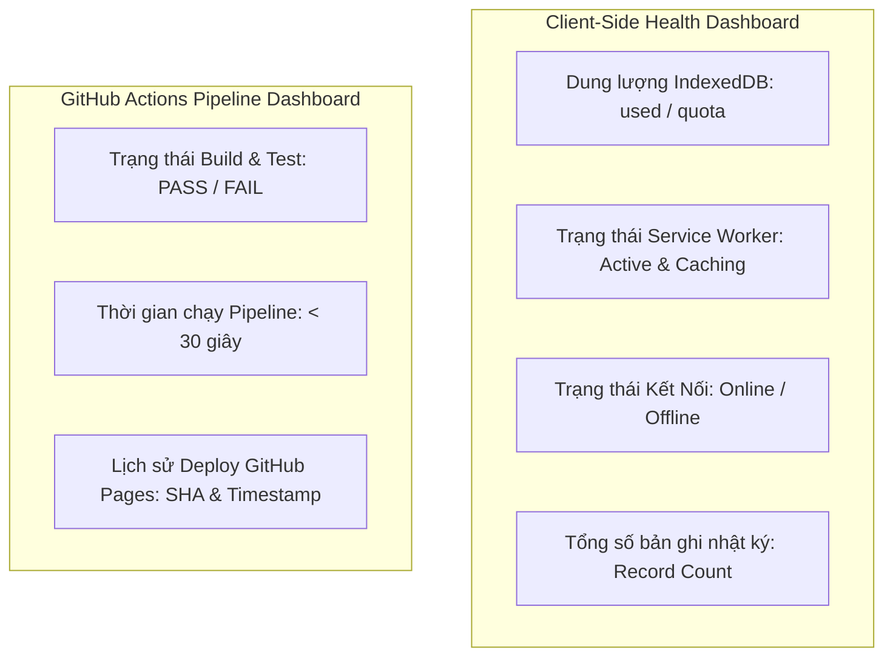

# Bảng Điều Khiển Giám Sát (Observability Dashboards) - MeowMindLog

## 1. Bảng Chẩn Đoán Cục Bộ Trong Ứng Dụng (In-App Client Dashboard)
Vì MeowMindLog hoạt động hoàn toàn offline trên trình duyệt và thiết bị Android, bảng điều khiển chẩn đoán được tích hợp trực tiếp trong ứng dụng (thông qua tab Sao Lưu và DevTools console):

| Chỉ Số Hiển Thị | Vị Trí / Cơ Chế | Ý Nghĩa Chẩn Đoán |
| :--- | :--- | :--- |
| **Dung Lượng Bộ Nhớ** | `navigator.storage.estimate()` | Giám sát dung lượng IndexedDB đã dùng so với hạn mức bộ nhớ máy Android |
| **Tổng Số Việc Ghi Chép** | Tab "📊 Biểu Đồ" & "💾 Sao Lưu" | Đếm tổng số bản ghi nhiệm vụ đang được lưu trữ an toàn trong máy |
| **Trạng Thái Ngoại Tuyến** | `navigator.onLine` / Banner Tag | Báo hiệu ứng dụng đang vận hành ở chế độ Offline hay Online |
| **Vòng Đời Service Worker** | `navigator.serviceWorker.controller` | Đảm bảo Service Worker đang kiểm soát việc nạp cache cho toàn trang |

---

## 2. Bảng Theo Dõi Quy Trình CI/CD (GitHub Actions Dashboard)
- **Huy hiệu trạng thái (Status Badge)**: ``
- **Thời gian thực thi trung bình**: 20 - 35 giây (nhờ zero-build và không cần nạp container nặng).
- **Tần suất kiểm tra**: Kích hoạt tự động trên mỗi lượt merge/commit vào `main`.
