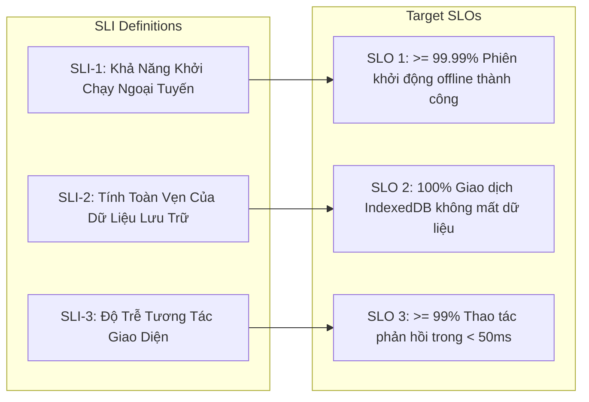

# Cấu Hình SLO / SLI & Quản Lý Ngân Sách Lỗi (SLO Configuration) - MeowMindLog

## 1. Các Chỉ Số Mức Dịch Vụ (Service Level Indicators - SLIs)

### Chi tiết các SLI:
1. **SLI-1 (Offline Launch Reliability)**: Tỷ lệ số lần mở ứng dụng khi không có mạng được nạp thành công từ Service Worker Cache Storage.
   $$\text{SLI-1} = \frac{\text{Số lần mở ứng dụng offline thành công}}{\text{Tổng số lần mở ứng dụng}} \times 100\%$$

2. **SLI-2 (Data Persistence Correctness)**: Tỷ lệ các thao tác Thêm / Sửa / Đánh dấu hoàn thành được cam kết (committed) thành công vào `IndexedDB`.
   $$\text{SLI-2} = \frac{\text{Số thao tác ghi dữ liệu thành công}}{\text{Tổng số thao tác ghi dữ liệu yêu cầu}} \times 100\%$$

3. **SLI-3 (Interaction Latency)**: Tỷ lệ các thao tác lọc danh mục, chuyển tab và hiển thị biểu đồ hoàn thành trong vòng dưới 50ms.
   $$\text{SLI-3} = \frac{\text{Số tương tác UI hoàn thành < 50ms}}{\text{Tổng số tương tác UI}} \times 100\%$$

---

## 2. Mục Tiêu Mức Dịch Vụ (Service Level Objectives - SLOs)

| Mã SLO | Mục Tiêu Định Lượng | Cửa Sổ Đo Lường | Ngân Sách Lỗi (Error Budget) |
| :--- | :--- | :--- | :--- |
| **SLO-1 (Khả năng ngoại tuyến)** | **$\ge$ 99.99%** | Cửa sổ trượt 30 ngày | 0.01% (Tối đa 4.3 phút gián đoạn/tháng) |
| **SLO-2 (Tính toàn vẹn dữ liệu)** | **100.00%** | Toàn bộ vòng đời ứng dụng | 0% (Không chấp nhận bất kỳ thất thoát dữ liệu nào) |
| **SLO-3 (Tốc độ phản hồi)** | **$\ge$ 99.00%** | Cửa sổ trượt 30 ngày | 1.00% tương tác vượt quá 50ms |

---

## 3. Chính Sách Ngân Sách Lỗi (Error Budget Policy)
- **Nếu vi phạm SLO-2 (Mất dữ liệu)**: Lập tức dừng phát triển tính năng mới, ưu tiên cao nhất cho việc kiểm tra transaction IndexedDB và nâng cấp cơ chế tự động backup.
- **Nếu ngân sách lỗi của SLO-1 bị suy giảm**: Kiểm tra lại danh sách file trong `ASSETS_TO_CACHE` và quy trình đăng ký Service Worker.
