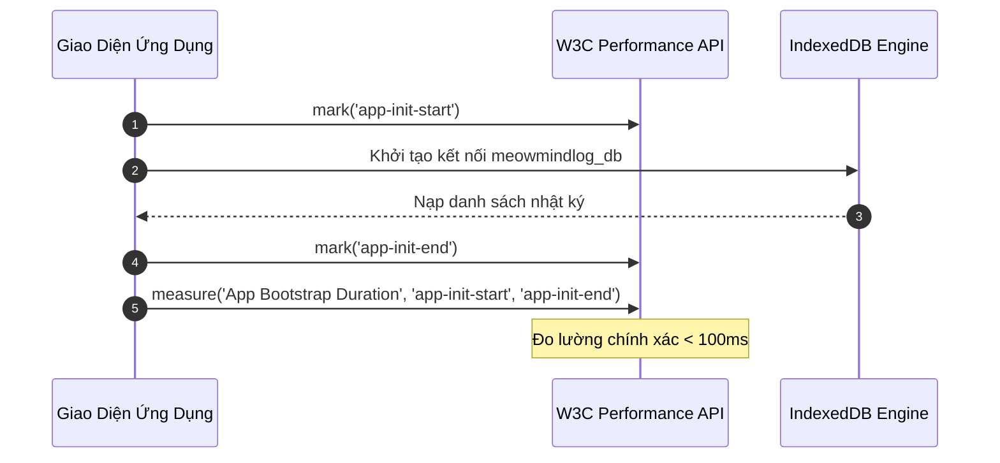

# Cấu Hình Truy Vết Hiệu Năng (Tracing Configuration) - MeowMindLog

## 1. Cơ Chế Truy Vết Trải Nghiệm Người Dùng (Client Performance Tracing)
Để tối ưu hóa trải nghiệm mượt mà trên thiết bị di động Android mà không làm chậm máy hoặc vi phạm quyền riêng tư, MeowMindLog sử dụng bộ công cụ chuẩn **W3C User Timing API** (`performance.mark` và `performance.measure`).

---

## 2. Các Luồng Đo Lường Then Chốt (Key Traced User Journeys)

| Luồng Tracing | Điểm Bắt Đầu (Mark) | Điểm Kết Thúc (Mark) | Ngưỡng Kỳ Vọng | Hành Động Khi Vượt Ngưỡng |
| :--- | :--- | :--- | :--- | :--- |
| **Khởi Động Ứng Dụng** | `app-init-start` | `app-init-end` | $< 150\text{ ms}$ | Tối ưu hóa kích thước DOM và hoãn nạp tab phụ |
| **Ghi Bản Ghi Mới** | `task-save-start` | `task-save-end` | $< 25\text{ ms}$ | Kiểm tra index và transaction scope của IndexedDB |
| **Vẽ Lưới Nhiệt 52 Tuần** | `heatmap-render-start` | `heatmap-render-end` | $< 35\text{ ms}$ | Sử dụng `DocumentFragment` để gom nhóm các thao tác DOM |
| **Xuất / Nhập Sao Lưu** | `backup-export-start` | `backup-export-end` | $< 500\text{ ms}$ | Sử dụng Blob URL truyền trực tiếp để tránh tràn RAM |

---

## 3. Bảo Vệ Quyền Riêng Tư (Zero Remote Telemetry)
Mọi dấu vết hiệu năng (performance traces) chỉ tồn tại trong bộ nhớ tạm thời của phiên làm việc trên trình duyệt của người dùng. Hệ thống **không gửi bất kỳ dữ liệu tracing nào ra máy chủ bên ngoài**, đảm bảo sự riêng tư và bảo mật tuyệt đối cho nhật ký cá nhân.
